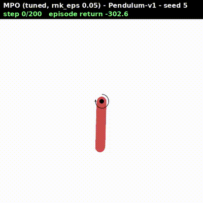
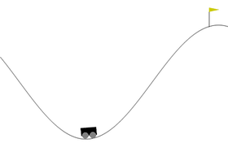
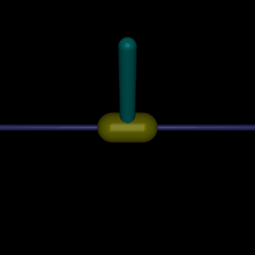
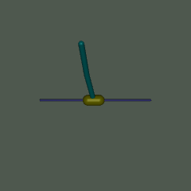
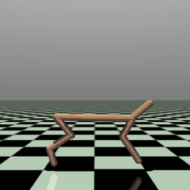
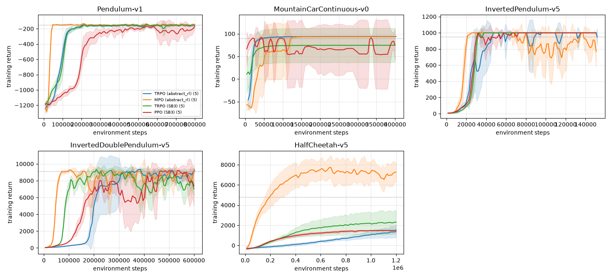

# Abstract RL

[](https://github.com/kosmitive/abstract_rl/actions/workflows/ci.yml)
[](https://www.python.org/downloads/)
[](LICENSE)

Modular [MLX](https://github.com/ml-explore/mlx) implementations of **TRPO** and **MPO** for continuous control, built from small composable pieces
(environment wrapper, trajectory operators, policies, value functions). Python 3.13, [uv](https://docs.astral.sh/uv/),
ruff, mypy; runs on Gymnasium environments with one- and multi-dimensional actions and is benchmarked against
Stable-Baselines3. This branch is an experimental port of the PyTorch version on `main`, see
[MLX port (experiment)](#mlx-port-experiment).

| MPO on Pendulum-v1 (swing-up from hanging down) | MPO on MountainCarContinuous-v0 | MPO on InvertedPendulum-v5 |
|---|---|---|
|  |  |  |
| **MPO on InvertedDoublePendulum-v5** | **MPO on HalfCheetah-v5** | |
|  |  | |

The GIFs show one greedy episode of the best MPO policy per environment (highest greedy return over all runs).

- **TRPO**: Trust Region Policy Optimization ([Schulman et al., 2015](https://arxiv.org/abs/1502.05477)) with
  [GAE](https://arxiv.org/abs/1506.02438), conjugate gradient natural gradient step and a KL line search.
- **MPO**: Maximum A Posteriori Policy Optimization ([Abdolmaleki et al., 2018](https://arxiv.org/abs/1806.06920)) with
  a non-parametric E-step, a KL constrained M-step and a [Retrace](https://arxiv.org/abs/1606.02647) critic.
- Univariate and diagonal (multi-dimensional) Gaussian policies, optionally tanh-squashed into the action bounds.

## Install

```bash
git clone https://github.com/kosmitive/abstract_rl.git && cd abstract_rl
uv sync                                   # add --extra mujoco and/or baselines for the benchmark extras
uv run python -m abstract_rl.scripts.run env=pendulum alg=trpo seed=1
```

MLX uses Metal on Apple silicon and its CPU backend on Linux (`mlx[cpu]`). PyTorch is only needed for the SB3
baselines (`--extra baselines`). It comes from the CPU wheel index; remove the `[tool.uv.sources]` entry in
`pyproject.toml` for the default CUDA build.

## Results

Configurations are Hydra YAML files in [`src/abstract_rl/conf/`](src/abstract_rl/conf) (`run env=<env> alg=<alg> seed=N`),
**5 seeds (1-5) per cell**, and every algorithm gets the same environment-step budget per environment (`steps` in `conf/env/<env>.yaml`).
*Greedy return* is the mean of 20 seeded evaluation episodes with the policy mean (final policy), averaged over seeds
± std over seeds. *Solved* counts seeds whose greedy return reaches the threshold (Gymnasium reward threshold;
Pendulum-v1 has none, -150 corresponds to swing-up and balance). *Steps to threshold* is the first step at which the
smoothed training return reaches it (median over the seeds that do). The table was made with the PyTorch
implementation of `main` (eb41282); the learning results of the MLX port are in
[MLX port (experiment)](#mlx-port-experiment).

| Environment | Algorithm | Seeds | Steps | Greedy return (mean ± std) | Solved | Steps to threshold |
|---|---|---|---|---|---|---|
| Pendulum-v1 (≥ -150) | TRPO (abstract_rl) | 5 | 800,000 | -127.7 ± 2.7 | 5/5 | 192,000 (5/5) |
| Pendulum-v1 (≥ -150) | MPO (abstract_rl) | 5 | 800,000 | -123.3 ± 0.4 | 5/5 | 36,000 (5/5) |
| Pendulum-v1 (≥ -150) | TRPO (SB3) | 5 | 800,000 | -124.0 ± 1.6 | 5/5 | 204,000 (5/5) |
| Pendulum-v1 (≥ -150) | TD3 (SB3) | 5 | 800,000 | -120.9 ± 1.0 | 5/5 | 36,000 (5/5) |
| MountainCarContinuous-v0 (≥ 90) | TRPO (abstract_rl) | 5 | 401,254 | 94.1 ± 0.7 | 5/5 | 44,286 (5/5) |
| MountainCarContinuous-v0 (≥ 90) | MPO (abstract_rl) | 5 | 400,038 | 93.6 ± 0.0 | 5/5 | 56,000 (5/5) |
| MountainCarContinuous-v0 (≥ 90) | TRPO (SB3) | 5 | 400,072 | 74.7 ± 37.5 | 4/5 | 52,013 (4/5) |
| MountainCarContinuous-v0 (≥ 90) | TD3 (SB3) | 5 | 399,966 | 54.9 ± 77.4 | 4/5 | 28,993 (4/5) |
| InvertedPendulum-v5 (≥ 950) | TRPO (abstract_rl) | 5 | 151,370 | 1000.0 ± 0.0 | 5/5 | 28,000 (5/5) |
| InvertedPendulum-v5 (≥ 950) | MPO (abstract_rl) | 5 | 150,357 | 1000.0 ± 0.0 | 5/5 | 20,000 (5/5) |
| InvertedPendulum-v5 (≥ 950) | TRPO (SB3) | 5 | 150,523 | 1000.0 ± 0.0 | 5/5 | 29,000 (5/5) |
| InvertedPendulum-v5 (≥ 950) | TD3 (SB3) | 5 | 149,310 | 1000.0 ± 0.0 | 5/5 | 25,000 (5/5) |
| InvertedDoublePendulum-v5 (≥ 9100) | TRPO (abstract_rl) | 5 | 605,543 | 9332.8 ± 3.8 | 5/5 | 431,112 (5/5) |
| InvertedDoublePendulum-v5 (≥ 9100) | MPO (abstract_rl) | 5 | 600,620 | 9332.9 ± 7.4 | 5/5 | 66,110 (5/5) |
| InvertedDoublePendulum-v5 (≥ 9100) | TRPO (SB3) | 5 | 599,517 | 8270.3 ± 602.2 | 0/5 | 107,946 (5/5) |
| InvertedDoublePendulum-v5 (≥ 9100) | TD3 (SB3) | 5 | 599,243 | 9347.9 ± 10.3 | 5/5 | 26,996 (5/5) |
| HalfCheetah-v5 (≥ 4800) | TRPO (abstract_rl) | 5 | 1,200,000 | 4471.7 ± 1645.7 | 3/5 | 732,000 (2/5) |
| HalfCheetah-v5 (≥ 4800) | MPO (abstract_rl) | 5 | 1,200,000 | 7940.5 ± 1398.2 | 5/5 | 210,000 (5/5) |
| HalfCheetah-v5 (≥ 4800) | TRPO (SB3) | 5 | 1,200,000 | 2547.9 ± 1314.1 | 0/5 | never |
| HalfCheetah-v5 (≥ 4800) | TD3 (SB3) | 5 | 1,200,000 | 11009.6 ± 522.5 | 5/5 | 96,000 (5/5) |

Learning curves of the four algorithms on environment steps (training return, mean ± std over the 5 seeds; the
runs of the table):



- **Tuned for Pendulum-v1 and MountainCarContinuous-v0** (one setting each): TRPO Pendulum discount 0.95, MPO
  Pendulum E-step epsilon `rnk_eps` 0.05, MPO MountainCar fixed (not learned) exploration std 2.0. A learned std
  shrinks to ≈ 0 before the sparse goal is found, so MountainCar uses a fixed standard deviation. These runs stop at the exact
  step budget (`max_env_steps`).
- **Pendulum balance check** (`scripts/eval_balance.py`, |θ| < 0.1 rad in the last 100 of 200 steps, 20 start
  states): TRPO and MPO balance in 5/5 seeds and 20/20 episodes each (max |θ| 0.012-0.057 rad TRPO, 0.032-0.098 rad MPO).
- **SB3 baselines**: TRPO uses the library defaults, except on MountainCarContinuous-v0, which uses the
  [rl-baselines3-zoo](https://github.com/DLR-RM/rl-baselines3-zoo) hyper-parameters (`--zoo`, gSDE exploration) at
  the same 400k budget; with the defaults it scores 0 there. On Pendulum-v1 the zoo settings were worse than the
  defaults (-136), so the defaults are shown. TD3 always uses the zoo hyper-parameters (`ZOO` in
  `scripts/run_baselines.py`); on MountainCarContinuous-v0 one of five seeds (seed 3) never finds the goal (-99.9).
- **MPO tuned for InvertedPendulum and InvertedDoublePendulum** (one setting each, see `conf/tune/`): a 300k
  instead of 50k replay memory (`tc_size`) on InvertedPendulum (4/5 → 5/5 seeds) and a KL trust region
  (`mpo_trust_regions`) of 0.005 instead of 0.01 on InvertedDoublePendulum (3/5 → 5/5); both remove the late-training
  collapse of single seeds. HalfCheetah MPO is not re-tuned. MPO stops after a fixed number of epochs and finishes the
  running episode, so on the two pendulums it ran up to 5% (InvertedPendulum) and 7% (InvertedDoublePendulum) past the
  budget; the learning curves are cut at the budget, the greedy return is the one of the final policy.
- **TRPO tuned for InvertedDoublePendulum and HalfCheetah** (see `conf/tune/`): InvertedDoublePendulum 75 × 8000
  steps with a KL trust region of 0.005, HalfCheetah 300 × 4000 steps with a KL trust region of 0.02 and `obs_norm`,
  both without the value L2 penalty (InvertedDoublePendulum 2/5 → 5/5, HalfCheetah 0/5 → 3/5 seeds).
- Runs were made on Linux and a MacBook (Python 3.13) with one CPU thread; seeds are fixed but
  results are not bit-reproducible across machines.

## Usage

```bash
uv run python -m abstract_rl.scripts.run env=halfcheetah alg=mpo seed=1 alg.num_epochs=100  # Hydra overrides
uv run python -m abstract_rl.scripts.run env=mountaincar alg=mpo data_root=results -m seed=1,2,3,4,5  # sweep
uv run python -m abstract_rl.scripts.run env=pendulum alg=trpo --cfg job              # print the config
uv run python -m abstract_rl.scripts.eval_returns data/HalfCheetah-v5/mpo/<run> --save       # greedy evaluation
uv run python -m abstract_rl.scripts.eval_balance data/Pendulum-v1/trpo/<run>              # Pendulum balance check
uv run python -m abstract_rl.scripts.run_baselines HalfCheetah-v5 td3 --seed 1 --data-root results
uv run python -m abstract_rl.scripts.compare results --out docs/                         # table and plots
uv run python -m abstract_rl.run.run_policy data/Pendulum-v1/trpo/<run> --render         # replay a policy
```

Configuration ([Hydra](https://hydra.cc)) ships inside the package in `src/abstract_rl/conf/`: `config.yaml` (`seed`,
`data_root`, `max_env_steps`, `device`), `alg/{trpo,mpo}.yaml` (Pendulum-v1 defaults), `env/<env>.yaml` (Gymnasium `id`,
`success` threshold, `steps` budget), `tune_all/<env>.yaml` (overrides for both algorithms) and
`tune/<env>_<alg>.yaml` (per-algorithm overrides). Environments: `pendulum`,
`mountaincar`, `inverted_pendulum`, `inverted_double_pendulum`, `halfcheetah`. `alg.<key>=...` overrides beat the
tune files. The training loops get a flat dictionary with prefixes (`env_*`, `policy_*`, `val_*`, `trpo_*`,
`mpo_*`). Runs are written to `data/<env>/<alg>/<timestamp>/` (configuration, returns, models, plots).
Environments with another action dimension work out of the box: `select_policy` chooses the univariate or the
diagonal Gaussian policy from the action space.

## Architecture

```
src/abstract_rl/
├── algorithms/
│   ├── continuous/policy_gradient/   TRPO and MPO (policy update rules)
│   └── mixed/                        conjugate gradient, trust region gradient (natural gradient + line search),
│                                     vanilla gradient (Adam), non-parametric temperature dual
├── data_structures/
│   ├── abstract_conf/                SharedConf (namespaced config), ModelConfiguration (registry, target sync, IO)
│   └── temporal_difference_data/     Trajectory, TrajectoryBuilder, TrajectoryCollection (replay), Batch
├── env/                              RolloutEnvWrapper: runs whole episodes of a policy in a Gymnasium env
├── interop/                          optional shared JAX rollout (one policy buffer, sharded CPU envs)
├── operator/                         trajectory operators: TD, GAE, Retrace, action resampling, MPO reweighting, filters
├── policy/                           univariate and diagonal Gaussian policy (+ select_policy), non-parametric policy
├── value_functions/                  fully connected V and Q networks
├── neural_modules/                   MLP building block
├── run/                              training loops (run_trpo, run_mpo_non_parametric), policy replay
├── scripts/                          Hydra entry point (run.py, hydra_conf.py), evaluate / baselines / compare
└── misc/ and plots/                  CLI printer, data logger, running filters, plots
```

A training loop is a sequence of operator applications on trajectory collections:

- **TRPO** per epoch: collect `policy_batch_size` steps → `TD` operator (returns, bootstrapped at time limits) →
  `GAE` operator → natural gradient step with KL trust region → V function fit (Adam).
- **MPO** per epoch: collect `env_sample` steps into the replay collection → `Resample` operator (actions from the
  target policy, evaluated by the target Q) → temperature dual + `VariationalRanking` operator (non-parametric
  E-step) → KL constrained weighted maximum likelihood (M-step) → `Retrace` operator → Q function fit (Adam).

Target networks are registered as `Syncable`s in the `ModelConfiguration` and synced with `mc.sync()`.

## MLX port (experiment)

This branch replaces PyTorch with [MLX](https://github.com/ml-explore/mlx) (`mlx>=0.32.4`) in the existing
modules. There is no backend abstraction: the layout, the operators and the training loops are the ones of `main`
(eb41282). The Gymnasium environments run on the host. The networks and the optimization run on the MLX device set by
`device` in `conf/config.yaml`:

- `cpu` or `gpu` (Metal) select the device directly.
- `auto` is the default. It selects the GPU for MPO, if Metal is available, and the CPU for TRPO (see the
  throughput below).
- With MPO on the GPU, the rollout still evaluates the policy on the CPU stream (`env_rollout_on_cpu: true` in
  `conf/alg/mpo.yaml`). One small policy evaluation per environment step is faster on the CPU, and the parameters
  are shared through the unified memory, so nothing is copied.

### Deviations from the PyTorch version

- **Compiled steps.** The TRPO step (surrogate, Fisher-vector products via `jvp` of `grad`, conjugate gradient, line
  search) is one `mx.compile`d function. The conjugate gradient runs a fixed number of iterations and freezes the
  iterate once it has converged, instead of exiting early. The line search evaluates all step sizes and selects the
  first accepted one with `where`. The Adam steps of the V and Q functions, the MPO M-step and the temperature dual
  are compiled as well, with the parameters and the Adam moments as implicit state.
- **Precision.** Everything is float32, except the MPO temperature dual. The dual runs in float64 on the CPU, as
  before, and in float32 on the GPU, because Metal has no float64.
- **Random numbers.** MLX has its own generator, so a seed draws other actions than in the PyTorch version. Runs
  are seeded, but they are not identical to the ones of `main`.
- **Diagonal covariance only.** `cov_type: full` raises an error, because `mx.linalg.cholesky` has no gradient
  (vjp).
- **Minibatches.** The M-step and the V and Q fits gather their minibatches on the device from one flat float32
  copy of the replay memory per fit (`FlatReplay`). The indices are drawn with the same numpy calls as in
  `TrajectoryCollection.sample`, so the batches are identical. The V and Q fits and the M-step run ten Adam steps
  per compiled call; the log line of every tenth step is printed after the fit.
- **Batched annotation.** The resampling, the Q annotation and Retrace run over all trajectories at once, in calls of
  2,048 states (compiled) on the GPU and 512 states (not compiled, which is faster on the MLX CPU) on the CPU. The
  noise is still drawn per trajectory, and the Retrace bootstrap stops at trajectory seams. The annotations, the
  temperature dual and the ranking stay on the device. This changes the results by float rounding only.
- **Buffer cache.** `default_settings` caps the MLX buffer cache at 2 GiB (`misc/mixed.py`). Without a cap it grows
  to the memory limit.
- **ELU.** `mlx.nn.elu` has a NaN gradient for pre-activations above about 88. The port uses its own ELU
  (`misc/mixed.py`). Without it, the MPO critic diverges after about 25 epochs on Pendulum.
- **Storage.** Models are stored as safetensors instead of `torch.save` files.
- **Dependencies.** PyTorch is only part of the `baselines` extra (SB3).
- **Not used:** `vmap` over seeds and custom kernels. Seeds run as separate processes.

### Tests and Metal checks

- `tests/test_torch_parity.py` compares the port with a fixture of the PyTorch implementation on the same weights
  and batches. It covers the policy log-likelihood, mode and KL, the conjugate gradient, the TRPO step, the V and Q
  Adam steps, TD, GAE, Retrace, the temperature dual and the M-steps.
- `tests/test_mlx_capabilities.py` checks the MLX features the port relies on.
- `tests/test_metal.py` compares Metal with the CPU and is skipped without Metal:

| Metal vs CPU (M3 Max) | max abs diff | other |
|---|---|---|
| scatter-add gradient (duplicate indices) | 2.4e-7 | max \|g\| 3.8 |
| compiled TRPO step, parameters | 8.4e-6 | norm rel 5.5e-6, step norm rel 2.7e-4 |
| Q annotation 50k × 20 | 3.6e-7 | CPU 1.33 s, GPU 0.033 s |

### Throughput (MacBook M3 Max, Pendulum-v1, environment steps per second)

Notes on the setup:

- All runs use nice 10 and are run one configuration at a time. Other jobs were running on the machine, so the
  numbers vary by about 10–30% between repetitions.
- TRPO is measured on epochs 6–11 (4,000 steps per epoch). MPO uses 1,000 steps per epoch. Its cost grows with the
  replay memory, so MPO is reported at three memory sizes:
  - epochs 1–4: up to 5k transitions
  - epochs 15–24: about 20k transitions
  - epochs 50–59: the full 50k memory, which is how most of a run looks
- "5 seeds" is 5 processes summed for torch and MLX. The JAX rows come from the JAX port (PR #9, measured on the same
  Mac on 2026-10-23). JAX jits the whole epoch, including JAX versions of the environments (gymnax), instead of
  Gymnasium. Its "5 seeds" is one process, looping over the seeds (`loop`) or vmapping them (`vmap`), and its MPO
  number is measured on epochs 1–11.
- The MLX numbers for MPO epochs 50–59 include the speedups described below the tables (re-timed on
  2026-10-24). The other MPO columns were measured before them.

| Implementation | Device | TRPO, 1 seed | TRPO, 5 seeds | MPO epochs 1–4, 1 seed | MPO epochs 1–4, 5 seeds | MPO epochs 15–24 | MPO epochs 50–59 |
|---|---|---|---|---|---|---|---|
| torch (`main`) | CPU | 5,272 | 25,471 | 542 | 2,427 | 222 | 124 |
| torch (`main` + 3 fixes) | MPS | 245 | 1,171 | 38 | 170 | – | – |
| **MLX (this branch)** | **CPU** | **6,357** | **26,054** | **1,068** | **3,730** | **444** | **385** |
| **MLX (this branch)** | **GPU** | 2,478 | 10,952 | **1,086** | **3,940** | **523** | **2,135** |
| JAX (PR #9) | CPU | 61,860 | 85,167 loop / 65,837 vmap | 963 | 2,271 loop / 1,076 vmap | – | – |
| JAX (PR #9) | Metal (jax-mps) | 2,469 | 11,469 vmap | 316 | 1,307 vmap | – | – |

Seconds per epoch by phase, MPO at epochs 50–59 (full memory):

| Implementation | rollout | resample + annotation | E-step | M-step | Retrace | Q fit | epoch |
|---|---|---|---|---|---|---|---|
| torch (`main`), CPU | 0.12 | 1.50 | 1.72 | 0.38 | 0.91 | 3.42 | 8.07 |
| MLX, CPU, before the speedups | 0.09 | 0.83 | 0.75 | 0.24 | 0.55 | 1.97 | 4.45 |
| MLX, GPU, before the speedups | 0.35 | 0.14 | 0.10 | 0.24 | 0.13 | 2.00 | 3.00 |
| **MLX, CPU** | 0.08 | 0.79 | 0.62 | 0.05 | 0.46 | 0.57 | 2.60 |
| **MLX, GPU** | 0.08 | 0.04 | 0.07 | 0.04 | 0.03 | 0.19 | 0.47 |

- **TRPO.** The rollout evaluates the policy once per environment step. On Metal every such call costs about
  0.4 ms of dispatch and synchronization, which makes the rollout 3× slower than on the CPU (1.5 s vs 0.48 s per
  epoch). The compiled TRPO step itself is faster on the GPU (0.012 s vs 0.034 s), but it is a small part of an
  epoch. MLX on the CPU is about 20% faster than torch on the CPU.
- **MPO.** With the full memory, resampling, annotation, E-step and Retrace are 4–8× faster on the GPU than on the
  MLX CPU. Before the speedups below, the Q fit (1,000 small Adam steps per epoch) cost about the same on both
  devices, and the rollout was slower on the GPU for the same reason as in TRPO. The first GPU epoch includes
  compilation and the Metal warm-up.
- Peak memory, with the 2 GiB cache cap: the MLX CPU runs reach about 2.7 GB RSS and MLX on the GPU about 0.7 GB,
  against 0.75 GB for torch. The batched annotation peaks at 0.5 GB of live MLX buffers on the CPU and 1.6 GB on the
  GPU.
- This is why `auto` uses the GPU for MPO and the CPU for TRPO.

**MLX speedups for MPO.** The per-step costs of the M-step and the Q fit were the host work around each small
step: walking the trajectories for a minibatch, the copy from numpy and one dispatch per Adam step. The rollout on
the GPU paid a Metal round trip per environment step. Two changes address this:

1. The minibatches are gathered on the device from one flat copy of the replay memory, and the value fits run ten
   Adam steps per compiled call. The results are bit-identical: the rewards of all 60 epochs are the same as before
   on both devices.
2. With the networks on the GPU, the rollout evaluates the policy on the CPU stream. This changes the results by
   float noise only (about 5e-7 on a 75-step rollout, `tests/test_metal.py`), which compounds over training.
3. The resampling, the Q annotation and Retrace run over all trajectories in a few large calls instead of one call
   per trajectory. The annotations, the temperature dual and the ranking stay on the device (float noise; the ranking
   differs from the numpy one by at most 4.8e-7).
4. The temperature dual and the M-step run 20 and 10 Adam steps per compiled call, and the rollout reads the log
   likelihoods once per episode. These are bit-identical.

Re-timed on 2026-10-24: MPO, seed 1, 60 epochs, the median epoch of epochs 50–59 (full memory), 3 repeats each, one
run at a time with nice 10. The load average was 5–14, from desktop apps. The repeats differ by less than 4%.

| MLX device | before (ebd5a3b) | 1. flat replay, ten Adam steps per call | 1. + 2. rollout on the CPU stream |
|---|---|---|---|
| GPU | 2.89 s, 346 steps/s | 0.92 s, 1,084 steps/s (3.1×) | 0.69 s, 1,442 steps/s (4.2×) |
| CPU | 4.35 s, 230 steps/s | 2.90 s, 345 steps/s (1.5×) | – (the rollout is on the CPU already) |

Steps 3 and 4 were timed the same way, at a load average of 4–6, against 84b558e (steps 1 and 2) as the baseline.
The repeats differ by less than 1.5%. The baseline took 0.64 s on the GPU in this session (0.69 s above, at a
higher load).

| MLX device | 1. + 2. (84b558e) | 1.–4. | gain |
|---|---|---|---|
| GPU | 0.638 s, 1,568 steps/s | **0.468 s, 2,135 steps/s** | 1.36× |
| CPU | 2.785 s, 359 steps/s | **2.595 s, 385 steps/s** | 1.07× |

On the GPU, the Q fit (1,000 small Adam steps, 39% of the epoch) is now the largest phase, ahead of the rollout (17%)
and the temperature dual (14%). On the CPU, the annotation and Retrace (48%) dominate. Batching them is not faster
there, because the MLX CPU spends that time in the network arithmetic, not in dispatch.

### torch with MPS

To compare, the PyTorch code of `main` was run with `device=mps`, using a local harness only. `main` itself was not
changed.

- **Unsupported ops.** With `PYTORCH_ENABLE_MPS_FALLBACK` unset, no operation is unsupported. The run fails for three
  code-level reasons:
  1. `torch.Tensor(ndarray)` and `from_numpy` create CPU tensors. `set_default_device` does not change that.
  2. `.numpy()` on an MPS tensor raises.
  3. The float64 temperature dual is not supported on MPS.
- **Fallback.** With these three points patched, TRPO and MPO run. With `PYTORCH_ENABLE_MPS_FALLBACK=1`, no
  operation falls back to the CPU.
- **Correctness.** MPS vs CPU on the same weights and batch:

  | Check | max abs diff | other |
  |---|---|---|
  | TRPO step (incl. CG and line search) | 1.5e-5 | norm rel 1.0e-5 |
  | MPO dual (float32 on MPS vs float64 on CPU) | 9.5e-7 | |
  | 3 M-steps | 1.5e-8 | |
  | Q annotation 50k × 20 | 3.3e-7 | 0.051 s on MPS vs 1.51 s on CPU |

- **Speed.** Per epoch the time goes to:
  - the rollout (TRPO 12.4 s, MPO 3.1 s), with one host-to-device copy and one synchronization per environment step
  - the V and Q fits (TRPO 2.9 s, MPO 21.5 s), with one copy per minibatch
  - In 12 TRPO epochs, the 55k host-to-device copies, 96k `float()` calls and 144k `.numpy()` calls cost 16 s, 32 s
    and 25 s. These times include waiting for queued GPU work.
- **Learning run.** A full learning run on MPS was skipped. At the measured speed it would take about 55 min for
  TRPO and more than 6 h for MPO.
- **Verdict.** torch with MPS computes correct results, but it is 14–22× slower than torch on the CPU for these
  small networks. It is not a viable alternative without restructuring the rollout and the minibatch loops, which
  would be an architecture change. The small fixes it needs anyway:
  - a device-aware tensor helper instead of `torch.Tensor(ndarray)`
  - `.cpu()` before `.numpy()`
  - a float32 dual on MPS
  - policy evaluation for the rollout on the CPU

### Learning (Pendulum-v1, 800k steps, 5 seeds, greedy return of the final policy over 20 episodes)

| Algorithm | MLX device | MLX: greedy return (mean ± std over seeds) | MLX: solved | torch (`main`) | JAX (PR #9) |
|---|---|---|---|---|---|
| TRPO | CPU | -124.5 ± 1.2 | 5/5 | -127.7 ± 2.7, 5/5 | -111.3, 5/5 |
| MPO | GPU (`auto`), rollout on the CPU stream | -122.7 ± 1.5 | 5/5 | -123.3 ± 0.4, 5/5 | -106.2, 5/5 |
| MPO | GPU, before the speedups (ebd5a3b) | -122.3 ± 1.6 | 5/5 | | |

Per seed (seeds 1–5): TRPO -123.4, -124.2, -126.5, -124.4, -124.1. MPO -120.6, -122.4, -124.4, -122.4, -123.8, and
before the speedups -120.9, -120.6, -122.3, -124.5, -123.1. The wall time for 800k steps is about 2 min for TRPO (CPU)
and about 11 min for MPO (GPU, two seeds at a time; 44 min before the speedups).

### Verdict

- **MLX is a reasonable drop-in replacement for PyTorch here.**
  - The port keeps the architecture.
  - It matches the PyTorch implementation numerically.
  - It learns as well: Pendulum 5/5 for both algorithms, with returns within the spread of `main`.
  - It is faster than torch on every configuration that was measured, by 1.2× for TRPO and up to 3.1× for MPO on
    the CPU, and 17× for MPO with the full memory on the GPU.
- **The GPU only helps MPO.** That is where large batched operations over the replay memory dominate. TRPO stays
  bound by the per-step policy evaluation of the Gymnasium rollout and is best on the CPU.
- **Remaining limits:** no full covariance (Cholesky without a gradient), one extra workaround (ELU), and
  Apple-only GPU support.
- **Compared with JAX.** The large speedups of the JAX port come from jitting the environments and whole epochs,
  not from the array library. That is an architecture change that this port deliberately does not make.

## Development

```bash
uv run ruff check . && uv run ruff format --check .   # lint and format
uv run mypy src                                        # types
uv run pytest                                          # unit and short training smoke tests
```

## Changes compared to the 2019 version

The original code (2019, Python 3.6, PyTorch 1.0, gym 0.12) targeted robot control experiments. The port keeps the
module layout and operator design. In short:

- uv + `pyproject.toml` (Python ≥ 3.13, src layout, `abstract_rl.*` imports), ruff, mypy, pytest; `gym` → `gymnasium`
  (`terminated`/`truncated`); modern PyTorch APIs. On this branch MLX replaces PyTorch, see
  [MLX port (experiment)](#mlx-port-experiment).
- Removed (still in the history of `main`): the experimental SAC, the dueling Q network, the circular tail
  memory, the robot specific scripts, unused helpers.
- Added: `DiagonalGaussianPolicy` for multi-dimensional actions, tanh action squashing, Hydra run configs,
  return based evaluation, SB3 baselines.
- Bug fixes needed for both algorithms to learn (see the commit history):
  TRPO surrogate broadcast (`[D,1]*[D]`), target-policy sync without sigma, time-limit episodes treated as terminal,
  replay index sampling, Q-function target broadcasting and state/action pairing, Retrace off-by-one and aliasing,
  MPO per-state weight normalisation and Adam temperature dual, unbounded
  Gaussian actions (now tanh-squashed with the Jacobian in the log-likelihood), Retrace policy mismatch, KL check
  in the TRPO line search, a larger ELU critic for MPO, and a state-dependent sigma that stays positive without
  being passed through softplus twice.

## Acknowledgements

- The running state filter (`misc/running_centered_filter.py`) is adapted from John Schulman's
  [modular_rl](https://github.com/joschu/modular_rl) and Ilya Kostrikov's
  [pytorch-trpo](https://github.com/ikostrikov/pytorch-trpo).
- The baselines use [Stable-Baselines3](https://github.com/DLR-RM/stable-baselines3),
  [SB3-Contrib](https://github.com/Stable-Baselines-Team/stable-baselines3-contrib) and hyper-parameters from
  [rl-baselines3-zoo](https://github.com/DLR-RM/rl-baselines3-zoo); the environments come from
  [Gymnasium](https://gymnasium.farama.org) and [MuJoCo](https://mujoco.org).

## Citing

If you use this code, please cite the repository (see [`CITATION.cff`](CITATION.cff)) and the papers of the methods:

```bibtex
@software{semmler_abstract_rl,
  author = {Semmler, Markus},
  title  = {Abstract RL: modular PyTorch TRPO and MPO},
  url    = {https://github.com/kosmitive/abstract_rl},
  year   = {2026}
}

@inproceedings{peters2010reps,
  author    = {Peters, Jan and M{\"u}lling, Katharina and Alt{\"u}n, Yasemin},
  title     = {Relative Entropy Policy Search},
  booktitle = {Proceedings of the 24th AAAI Conference on Artificial Intelligence (AAAI)},
  year      = {2010},
  pages     = {1607--1612},
  url       = {https://ojs.aaai.org/index.php/AAAI/article/view/7727}
}

@inproceedings{schulman2015trpo,
  author    = {Schulman, John and Levine, Sergey and Moritz, Philipp and Jordan, Michael I. and Abbeel, Pieter},
  title     = {Trust Region Policy Optimization},
  booktitle = {Proceedings of the 32nd International Conference on Machine Learning (ICML)},
  year      = {2015},
  url       = {https://arxiv.org/abs/1502.05477}
}

@inproceedings{schulman2016gae,
  author    = {Schulman, John and Moritz, Philipp and Levine, Sergey and Jordan, Michael I. and Abbeel, Pieter},
  title     = {High-Dimensional Continuous Control Using Generalized Advantage Estimation},
  booktitle = {International Conference on Learning Representations (ICLR)},
  year      = {2016},
  url       = {https://arxiv.org/abs/1506.02438}
}

@inproceedings{abdolmaleki2018mpo,
  author    = {Abdolmaleki, Abbas and Springenberg, Jost Tobias and Tassa, Yuval and Munos, Remi and Heess, Nicolas
               and Riedmiller, Martin},
  title     = {Maximum a Posteriori Policy Optimisation},
  booktitle = {International Conference on Learning Representations (ICLR)},
  year      = {2018},
  url       = {https://arxiv.org/abs/1806.06920}
}

@article{abdolmaleki2018rerpi,
  author    = {Abdolmaleki, Abbas and Springenberg, Jost Tobias and Degrave, Jonas and Bohez, Steven and Tassa, Yuval
               and Belov, Dan and Heess, Nicolas and Riedmiller, Martin},
  title     = {Relative Entropy Regularized Policy Iteration},
  journal   = {arXiv preprint arXiv:1812.02256},
  year      = {2018},
  url       = {https://arxiv.org/abs/1812.02256}
}

@inproceedings{munos2016retrace,
  author    = {Munos, R{\'e}mi and Stepleton, Tom and Harutyunyan, Anna and Bellemare, Marc G.},
  title     = {Safe and Efficient Off-Policy Reinforcement Learning},
  booktitle = {Advances in Neural Information Processing Systems (NeurIPS)},
  year      = {2016},
  url       = {https://arxiv.org/abs/1606.02647}
}
```

## Shared JAX rollout

The Gymnasium wrapper is the rollout the training loops use. `env_rollout_backend: jax`
is an opt-in that runs Pendulum, MountainCarContinuous, InvertedPendulum and
InvertedDoublePendulum on the JAX CPU and hands the trajectories to the same MLX
TRPO or MPO update. The policy is stored once. Value networks stay ordinary MLX modules.

JAX earns its place on the inverted pendulums. On an M3 Max (JAX 0.11.2 CPU, MLX 0.32.4),
a pure MLX GPU rollout was faster for Pendulum and MountainCar at 1024 environments and
above (30M steps/s on Pendulum at 4096). HalfCheetah stays on Gymnasium: MJX on that CPU
did 0.4k to 2.9k steps/s against 37k for Gymnasium, and this backend does not add it.

### One definition

`abstract_rl.interop.spec` is the layout and `abstract_rl.interop.forward` is the forward,
written once against a tiny array namespace (`mlx.core` or `jax.numpy`). Both frameworks
call that function. The weights are `[out, in]` then bias, layer by layer, which is how
`mlx.nn.Linear` multiplies. A trainable state-independent `log_sigma` sits at the end of
the vector. A frozen `log_sigma` is a separate argument, so training cannot move it.
Checkpoints are written back out under the names `select_policy` saves
(`network.layers.i.weight`, `bias`, `cov`), so `eval_returns` loads a JAX-trained policy
with the ordinary module.

The activation is the clamped ELU `where(x > 0, x, exp(minimum(x, 0)) - 1)`. `mlx.nn.elu`
produces NaN gradients for large positive inputs. Layer norm is mean and variance over the
last axis, epsilon `1e-5`, only after the first layer, with no affine, matching the MLP.

### Who owns the buffer

MLX allocates the vector. The allocation is sliced so the data pointer is 64-byte aligned,
which is what `jax.device_put` of a NumPy memoryview needs in order to alias the bytes.
`SharedParams.as_jax()` and `replicated()` are that alias. On JAX 0.12 CPU, replicating the
view onto several host devices with `NamedSharding` kept the MLX address on every device.
Pass the JAX array into `jit` as an argument. A closed-over device array becomes a
device-0 input, and `shard_map` rejects it. Donation does not give the arena back: on JAX
0.12 CPU, `donate_argnums` allocated a new address and left the MLX buffer untouched.

MLX updates return a new array. The bytes are copied back into the arena, and the module
is rebound to the view. That copy is one `float32` vector. A 64-64 univariate policy is
4482 floats. TRPO's compiled step cannot write the arena (evaluating a tracer raises);
the eager `set_flat` that follows the compiled step copies once per epoch. MPO's Adam
steps stay inside the compiled update, so the copy happens once per rollout, in
`export_for_rollout`, when the pointer has changed. Call `mx.eval` on the new parameters
before JAX reads them, and `block_until_ready` before MLX reads a JAX result.

On an M3 Max the parameter handoff was 160 to 430 µs per chunk and the trajectory handoff
was 25 to 160 µs, all zero-copy, under 3% of the step at 1024 environments and above. An
MLX GPU training step read that buffer at native speed. `mx.from_dlpack` of a JAX CPU
array is that zero-copy path on the Mac. This Linux CPU build of MLX refuses
`from_dlpack(..., copy=False)` for a CPU array, so the portable path is the aligned
memoryview.

### Sharding

One XLA host device uses a handful of cores. The rollout shards the env axis with
`shard_map` (`jax.shard_map`, or `jax.experimental.shard_map` on older JAX). The policy
vector is replicated. The keys are sharded. `n_envs` has to be a multiple of the device
count; the collector pads to that multiple and drops the padding.

Set the device count before the process imports JAX:

```bash
export XLA_FLAGS=--xla_force_host_platform_device_count=8
uv run python -m abstract_rl.scripts.run env=inverted_pendulum alg=trpo \
  alg.env_rollout_backend=jax alg.env_jax_devices=8 alg.env_jax_dtype=float64
```

`env_jax_devices` defaults to 1, which needs no flag. On the M3 Max, 8 or 16 devices
were the useful counts. At 4096 Pendulum environments the rate went from 3.44M to 27M
steps/s; InvertedPendulum went from 1.41M to 10.4M; InvertedDoublePendulum went from
0.54M to 3.9–5.0M, with about 11 or 12 cores busy. Separate processes gave 1.4–2x.
The sharded trajectories matched the single-device ones within 1e-6. JAX 0.12's manual-axis
check rejects a `lax.cond` that mixes a per-env value with a Python constant (the done
flag, the observation scale), so the scan passes `check_vma=False`.

The same benchmark on a 4-core Linux CPU (JAX 0.12.0.1, MLX 0.32.4, eight host devices
on four cores) is a different machine. Pendulum at horizon 50 went from 4.4M steps/s on
one device to 6.3M on eight, at 1024 environments. The parameter view shared the MLX
pointer, and copying the 4482-float vector first did not move the rate. The M3 Max
numbers above are the ones the sharding is for.

XLA does not fill a caller-owned buffer here. Each device's shard is copied once into
its slice of a preallocated MLX arena, and the episode is a view of that arena. Joining
the shards into one array first cost 0.9–2.6 ms per chunk on the M3 Max (1.5–21% of the
chunk). Training still concatenates episode rows when it builds a batch: the final
next-state sits between two episodes, so those rows are not one contiguous span.

### Dynamics dtype

`env_jax_dtype` is `float64` by default and `float32` for the fast path. It applies to
the inverted pendulums. Gymnax Pendulum and MountainCar stay float32. Requesting float64
sets `jax_enable_x64` for the process; without that, JAX stores the state as float32 and
warns. The flag stays on for later work in the same process.

The M3 Max measurements are the ones to plan around: float64 matched MuJoCo to 1e-14,
and float32 drifted by more than 1e-3 after about 50 steps, with the returns still
matching. A check on Linux (JAX 0.12, MuJoCo 3.17) saw float64 agree to about 1e-15 on
`q` and `v`. On the short upright episodes tried there, float32 stayed near 1e-7 and
once crossed the fall threshold two steps early. The double-pendulum reward uses the
tip of the final state. Gymnasium reads `site_xpos` from inside `mj_step`, which lags
that state, so the reward can differ by about 1e-5 while `q` and `v` already match.
The slider limits are not modelled, and `qfrc_constraint` in the observation is 0.

`render`, `obs_norm`, `filter_states` and `filter_rewards` raise on this backend.
`env_normalize` (divide observations by a finite positive `observation_space.high`) is
applied, as in `RolloutEnvWrapper`.

JAX and gymnax are optional. The package imports without them, and CI does not install
them (`uv sync` stays frozen). Install them beside the environment when you turn the
backend on: `uv pip install jax gymnax`. The micro-benchmark prints this machine's
handoff time and Pendulum steps/s, including a duplicated-parameter baseline:

```bash
PYTHONPATH=src python -m abstract_rl.interop.benchmark
```

## License

MIT, see [LICENSE](LICENSE).
